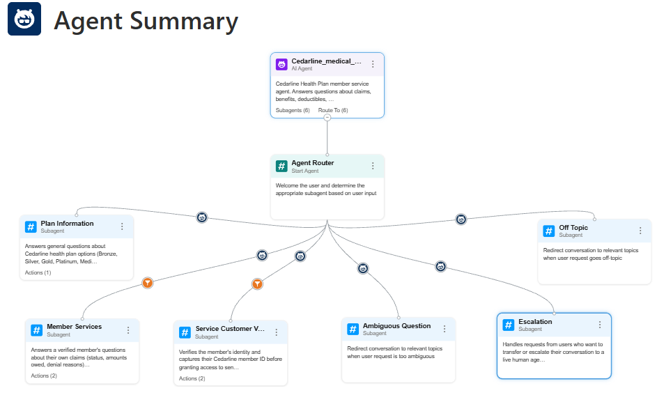
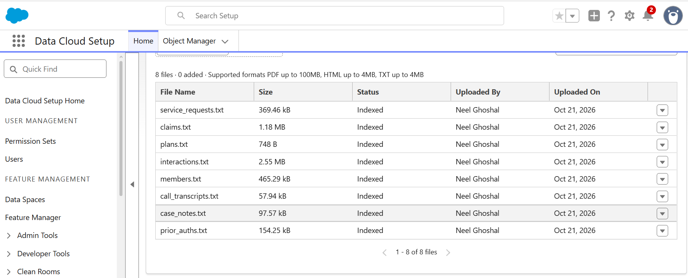
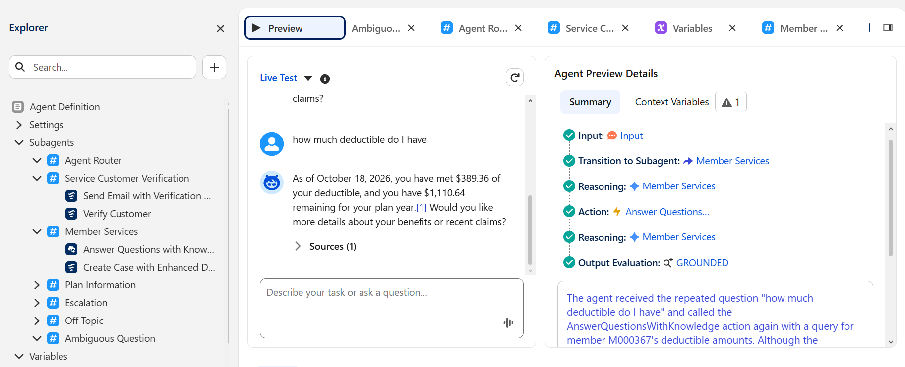

# Insurance_Service_Agent

Member service agent for **Cedarline Health Plan**, a hypothetical medical insurance company. Members can ask about their claims, denial reasons, deductible and out-of-pocket balances, prior authorizations and service requests, and open appeals. The agent verifies their identity first.

**Tech stack:** Python (pandas) · Snowflake · Salesforce Data Cloud (Data 360) · Agentforce Builder



## How it works

```
Synthea sample data ──► import_synthea.py ──► data/out/*.csv ──► load_snowflake.py ──► Snowflake (CEDARLINE.SERVICE)
                                                    │
                                                    └──► export_datacloud.py ──► data/datacloud/*.csv + schema.yaml
                                                                                        │
                                                    export_datalibrary.py ◄─────────────┘
                                                            │
                                                            ▼
                                     salesforce data library/*.txt ──► Agentforce Data Library ──► Agent
```

1. **Data generation.** `import_synthea.py` maps the Synthea sample patients, payers and claims (about 1,160 patients) onto Cedarline's member, plan and claims tables, and computes accumulators from those claims. It then generates seeded synthetic prior authorizations, service requests, interactions, call transcripts and case notes on top. These include hand-planted test stories and two prompt-injection case notes.
2. **Snowflake.** `ddl.sql` and `load_snowflake.py` load everything into `CEDARLINE.SERVICE`. `query_snowflake.py` runs sample queries against it.
3. **Data Cloud.** `export_datacloud.py` writes Data Cloud-ready CSVs (ISO-8601 timestamps, `true`/`false` booleans). `ingest_datacloud.py` generates the OpenAPI `schema.yaml` for the Ingestion API connector and can bulk-load the CSVs through the Ingestion API.
4. **Agentforce Data Library.** `export_datalibrary.py` turns each record into a self-contained plain-English paragraph, because the Data Library splits files into chunks for search. Members are joined with their plan and accumulators. The output TXT files stay under the 4 MB limit.
5. **Agent.** The agent is defined in Agent Script (`agentforce/`). It answers questions by searching the Data Library through the `Answer Questions with Knowledge` action.

## Data

| Table | Rows | Contents |
|---|---|---|
| plans | 6 | Bronze HMO, Silver HMO, Gold PPO, Platinum PPO, High-Deductible HSA, Medicare Advantage |
| members | 1,163 | Name, date of birth, email, ZIP, plan, status (active/terminated) |
| accumulators | 1,163 | Plan-year deductible and out-of-pocket amounts met |
| claims | 5,526 | Billed amount, member owes, status, denial reason (coverage terminated, out of network, duplicate, not medically necessary, missing prior auth) |
| prior_auths | 874 | Service code, status (approved/denied/pending), submitted and decided dates |
| service_requests | 2,328 | ID card, address change, appeal, grievance |
| case_notes | 583 | Notes on service requests |
| interactions | 14,540 | Channel, intent, handle time, resolved flag, CSAT |
| call_transcripts | 290 | Call summaries |

All data is synthetic, and the emails use `@example.com`.

### Salesforce Data Library

All 8 TXT files are uploaded and indexed in the Agentforce Data Library:



## The agent

| Subagent | Purpose | Requires verification |
|---|---|---|
| Agent Router | Classifies intent and routes to a subagent | — |
| Service Customer Verification | Captures the member ID (`M` + 6 digits), then verifies identity with an email code | — |
| Member Services | Claims, denial reasons, benefits and balances, prior authorizations, service requests. Creates appeal and grievance cases. | Yes |
| Plan Information | General plan comparisons (deductibles, out-of-pocket maximums) | No |
| Escalation / Off Topic / Ambiguous Question | Handoff to a human, and guardrails | No |

Design choices:
- **Small footprint.** There are 6 subagents and no custom flows. Only the template's verification and create-case flows are used.
- **Member scoping.** The verified member ID is stored in `memberID`. Every knowledge query includes it, and the agent must ignore records for any other member. It can't be changed after verification (`available when isVerified == False`).
- **Guardrails.** The agent gives no medical advice, doesn't predict prior-authorization outcomes or estimate future costs, and doesn't reveal internal note authors.

### Testing

`agentforce/cedarline_agent_script_TEST.txt` bypasses verification for preview testing: it starts verified as member `M000367`. **Revert to `cedarline_agent_script.txt` before activating the agent.**



Example prompts (member M000367, Gold PPO):

| Prompt | Expected |
|---|---|
| How much of my deductible have I met? | $389.36 met, $1,110.64 remaining (as of Oct 18, 2026) |
| Why was claim CLM00001191 denied? | Duplicate claim, $926.85 owed |
| What's the status of my prior authorization? | PA00000553 (PT-EVAL) pending |
| Show me claims for M000137 | Refuses, because that's another member's data |

## Known limitations

- **No row-level security in the Data Library.** Member scoping relies on instructions, not access control. That's fine for synthetic demo data. For production, use custom objects or Data Cloud DMOs with Flow or Apex actions that filter by the verified member.
- **Search, not queries.** Retrieval works well for lookups ("status of claim X"). It's unreliable for aggregates ("how many denied claims", "largest claim").
- **Verification needs a Contact.** The email verification flow matches a Salesforce Contact, so testing requires a Contact with a real email address.

## Repository layout

```
data/
  import_synthea.py       Synthea -> Cedarline tables (data/out/)
  ddl.sql                 Snowflake schema
  load_snowflake.py       Load data/out/ into Snowflake
  query_snowflake.py      Sample queries against Snowflake
  export_datacloud.py     data/out/ -> data/datacloud/ (Data Cloud format)
  ingest_datacloud.py     schema.yaml + Ingestion API bulk loader
  export_datalibrary.py   data/datacloud/ -> salesforce data library/*.txt
salesforce data library/  TXT files uploaded to the Agentforce Data Library
agentforce/               Agent Script (production and test-bypass versions)
docs/images/              Screenshots
```

## Setup

```bash
pip install -r data/requirements.txt
python data/import_synthea.py        # needs the Synthea sample CSVs in data/public/
python data/load_snowflake.py        # needs SNOWFLAKE_* in .env
python data/export_datacloud.py
python data/export_datalibrary.py
```

Then upload `salesforce data library/*.txt` to an Agentforce Data Library, attach it to the agent, and paste `agentforce/cedarline_agent_script.txt` into Agentforce Builder's script view.
